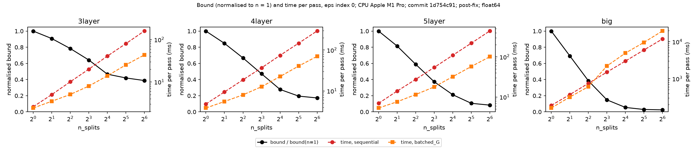

# Checkpoint 2026-11 - Pasado GPU/compiler work, state for the meeting with Prof. Misailović

Branch `checkpoint` (code commit `91ebd88` on top of `origin/gpu-hybrid` `1d754c9`, the state of the last update on
2026-10-28/29). Local machine of this checkpoint: **Apple M1 Pro** (8 performance + 2 efficiency
cores, 16 GB), macOS, Python 3.13.18, torch 2.12.1, CPU only (MPS float32 only, not used for
results). Every number below carries: code commit, device, dtype, repetitions, baseline, and
whether the code is before or after the soundness fix of 2026-10-21/22 (`b526762`).
"Not measured" means exactly that; nothing below is extrapolated.

The A100 parts are packaged as Colab notebooks (`colab/README.md`); the sections between
`<!-- BEGIN:... -->` markers are filled from their results by
`experiments/make_checkpoint_report.py --update-checkpoint`.

## 0. In five lines

1. **The soundness fix also fixes the plain-zonotope baseline, and that changes the paper's
   headline.** `SigmoidDualZonotope` uses the same broken `__neg__` in every layer. After the
   fix, the largest precise-vs-zonotope ratio of Section 5.4 is 3.0x / 4.9x / 8.1x / **8.8x**
   (3layer / 4layer / 5layer / big) instead of 10.4x / 34.2x / 118.8x / **181.8x** from the
   artifact's own `.pth` files (the paper says "up to 182x" on FFNNBig). Interval AD is
   untouched by the bug (ratio of bounds before/after = 1.0000). Local CPU, section 2.1.
2. Every result measured before 2026-10-21 is now marked PRE-FIX in the documents, including
   all auto_LiRPA/BaB/equal-time comparisons. While re-checking them I found that the old
   documents divide the auto_LiRPA sweep time by 25 solves, although the only version of the
   sweep script builds the BaB curve incrementally with 9 solves; if the archived CSV came from
   it (the CSV is outside the repository), auto_LiRPA times there are understated about 2.8x.
   A re-run on the same A100 for both tools is prepared (`colab/01c_lirpa_postfix.ipynb`).
3. GPU results from 2026-10-24 to 10-29 are post-fix and stand (section 2.2): A2 closed-form plane
   fit, batched splits, Inductor; big at 64 splits per pass 4590 ms (sequential gelsd) -> 221 ms
   (compiled whole sigmoid), A100-80GB.
4. Compilers: Inductor and JAX/XLA compile all ported kernels in float64; TVM 0.27 (local, CPU)
   stops in the PyTorch frontend for the plane fit (`frexp`/`ldexp`/`amax`) and silently computes
   `matmul` in float32; Neptune's pattern exists only on 5- to 25-element axes and is not worth
   trying (`docs/NEPTUNE_ANALYSIS.md`).
5. The "D falls short by <= 2.4 ulp in 51% of boxes" claim reproduces exactly, but the unit is
   eps * T (up to 3.9 ulp of T), and the median 0.2 is over the boxes that fall short. An
   outward-rounding prototype removes every shortfall on those boxes at a cost of 0-2% (CPU).

## 1. Done since the last update (2026-10-28/29)

The last update covered the compiled whole `precise_sigmoid` (v1 and v2 stopped by their gates,
v3 complete, outcome opt-in), the gelsd/A2 crossover (thresholds 512/640) and the automatic choice.
Since then (2026-11-06, this branch):

- P0a: PRE-FIX banners on all 17 documents of `results/optimization_section_5_4/`, table-level
  marks in `LIRPA_COMPARISON.md` and `EQUAL_TIME_COMPARISON.md`; `RESULTS.md` and
  `NEXT_RESEARCH_DIRECTIONS.md` brought in line with `FORMAL_SUMMARY.md` (status tables).
- Local post-fix CPU reference of the whole Section 5.4 matrix, per image (4 networks x 30 images
  x 16 eps; precise, zonotope, interval; float64 and float32; complex solver as control):
  `results/postfix_rerun_2026-11/cpu_reference/`. Source of section 2.1.
- Notebooks and pre-registered protocols for everything that needs an A100: post-fix re-run
  (`01`), auto_LiRPA on the same GPU (`01c`), compilers (`02`), deeper network (`03`); all
  resumable, tested end to end locally in a CPU test mode.
- P1 locally: torch.compile (Inductor C++), JAX/XLA CPU and TVM 0.27 CPU on the isolated kernels;
  Neptune analysis; Trainium note (`docs/TRAINIUM_NOTE.md`).
- P2: verification of the D-shortfall claim; outward-rounding prototype behind `PASADO_OUTWARD_D`
  (off); deep-network protocol and scripts.
- P3: `docs/PR_SPLIT_PLAN.md`.
- Checks on this machine (section 6): all existing tests, the soundness checker on a freshly
  computed sweep (264/264) and the mutation check (**29/29**; the brief's "10/10" predates
  mutants M11-M29).

## 2. Results

### 2.1 Section 5.4 after the fix (local, new)

*Post-fix; code `91ebd88` (get_lipschitz.py path, sequential, all four bit-identical selectors on,
real Viete cubic; computed on the working tree that was committed as `91ebd88`, and 4 of the 12
configurations recomputed with `91ebd88` itself: bit-identical); Apple M1 Pro CPU, 8 threads;
float64; seed 7; 30 images x 16 eps,
each value the 30-image mean of one run; baselines: the artifact's `Section_5_4/results/*.pth`
(upstream `main`, 2023, pre-fix, complex solver, unseeded) and the regenerated ones on
`gpu-hybrid` (2026-09-15, pre-fix, unseeded).* Raw: `results/postfix_rerun_2026-11/cpu_reference/`,
tables: `section54_postfix_vs_prefix.json`, `precise_vs_zonotope_ratio.json`.

Largest ratio zonotope / precise over the 16 epsilons (the paper's "x times more precise"):

| network | artifact `.pth` (2023, pre-fix) | `gpu-hybrid` `.pth` (2026-09, pre-fix) | **post-fix** | post-fix interval / precise (largest) |
|---|---:|---:|---:|---:|
| 3layer | 10.4x (eps 0.356) | 10.5x (0.356) | **3.0x** (0.2) | 65x (0.356) |
| 4layer | 34.2x (0.356) | 35.1x (0.2) | **4.9x** (0.2) | 398x (0.632) |
| 5layer | 118.8x (0.356) | 125.2x (0.2) | **8.1x** (0.2) | 2168x (0.632) |
| big | 181.8x (0.2) | 182.4x (0.2) | **8.8x** (0.2) | 5439x (0.0356) |

Selected 30-image means (full table in `section54_postfix_vs_prefix.json`):

| network | eps | precise: artifact / post-fix | zonotope: artifact / post-fix | interval: branch / post-fix |
|---|---:|---:|---:|---:|
| 3layer | 0.632 | 528.92 / 416.56 | 5010.43 / 1172.91 | 26933.87 / 26933.87 |
| 5layer | 0.632 | 3400.77 / 1954.89 | 376722.26 / 14341.58 | 4238476.01 / 4238476.01 |
| 5layer | 0.0632 | 508.46 / 597.90 | 21941.87 / 3137.28 | 894814.15 / 894814.15 |
| big | 0.632 | 12946.84 / 8030.65 | 2018183.28 / 59949.68 | 16110750.58 / 16110750.58 |
| big | 0.0632 | 818.70 / 910.91 | 47738.58 / 4219.86 | 3738427.70 / 3738427.70 |

Reading: the negation fix lowers the large-eps bounds of both zonotope analyses, the plain one far
more (its sigmoid applies the broken negation in every layer, the precise one only at the input);
the `|E|` fix raises the precise bound in the middle range (5layer eps 0.0632: +18% against the
artifact, +12% against the branch), i.e. the pre-fix precise bound was missing negative errors
there. Two further observations: the artifact's `.pth` and the branch's regenerated `.pth` (same
pre-fix code, different years and stacks, both unseeded) differ by up to 8% (4layer eps 0.0632:
379.31 vs 411.45) - the cause was not investigated; and the real and complex cubic give the same
post-fix 30-image means to <= 2.2e-5 relative on the CPU (<= 1.1e-4 per image).

**Soundness of these values** (`experiments/check_matrix_soundness.py`, 4001 sampled points per
(image, eps), `cpu_reference_soundness.csv`): all 1920 precise, 1920 zonotope and 1920 interval
bounds, and the 1920 complex-solver bounds, are above the sampled autograd maximum of |dF/dt|; the
smallest ratios over all four networks are 1.000002 (zonotope), 1.000045 (precise, both solvers) and
1.056 (interval). The much smaller post-fix zonotope bound is therefore not an unsound bound.

### 2.1b Split sweep after the fix on the local CPU (new; the mentor's figure, CPU version)

On this 16 GB laptop the batched pass does not pay on big beyond 4 splits (chunk 16: one
generator tensor is 16 x 6146 x 1024 doubles = 0.8 GB); on the small networks it is 3.7-4.4x faster
than the sequential loop at 64 splits. The A100 version comes from notebook 01, section A.
The label below says `1d754c9128 (dirty)` because the sweep ran on the uncommitted working tree
that was then committed as `91ebd88`; the library code is the same.

<!-- BEGIN:postfix_local_m1pro_cpu -->
**A. Split sweep** *post-fix; commit `1d754c9128` (dirty); GPU no GPU; host CPU Apple M1 Pro; torch 2.12.1, CUDA None; float64; 3 images; median of 3 timed passes after 1 warm-up pass; big batched chunk 16; baseline: n = 1 of the same mode*

Largest relative difference of a batched bound from the sequential bound: 9.39e-15 (criterion 1e-10: pass).
Soundness checker on the sequential rows (4001 sampled points): 84 rows, smallest bound / sampled maximum 1.012815, rows below: 0.

eps index 0 (mean over images; time = median ms per pass; VRAM = peak MiB):

| network | n | bound | bound / bound(n=1) | seq ms | batched_G ms | batched_auto ms | seq VRAM | batched_G VRAM | batched_auto VRAM |
|---|---:|---:|---:|---:|---:|---:|---:|---:|---:|
| 3layer | 1 | 492.18 | 1.000 | 2.6 | 2.4 | - | 0 | 0 | - |
| 3layer | 2 | 448.03 | 0.910 | 5.0 | 3.5 | - | 0 | 0 | - |
| 3layer | 4 | 395.29 | 0.803 | 10.1 | 5.0 | - | 0 | 0 | - |
| 3layer | 8 | 328.71 | 0.668 | 20.0 | 8.0 | - | 0 | 0 | - |
| 3layer | 16 | 239.27 | 0.486 | 40.8 | 13.9 | - | 0 | 0 | - |
| 3layer | 32 | 213.66 | 0.434 | 80.4 | 25.3 | - | 0 | 0 | - |
| 3layer | 64 | 195.17 | 0.397 | 160.6 | 43.6 | - | 0 | 0 | - |
| 4layer | 1 | 1213.33 | 1.000 | 4.8 | 3.8 | - | 0 | 0 | - |
| 4layer | 2 | 1055.13 | 0.870 | 9.4 | 5.5 | - | 0 | 0 | - |
| 4layer | 4 | 866.81 | 0.714 | 18.7 | 8.0 | - | 0 | 0 | - |
| 4layer | 8 | 638.75 | 0.526 | 36.7 | 12.7 | - | 0 | 0 | - |
| 4layer | 16 | 403.68 | 0.333 | 74.3 | 22.5 | - | 0 | 0 | - |
| 4layer | 32 | 282.89 | 0.233 | 147.2 | 40.6 | - | 0 | 0 | - |
| 4layer | 64 | 248.24 | 0.205 | 294.3 | 70.5 | - | 0 | 0 | - |
| 5layer | 1 | 2602.14 | 1.000 | 7.0 | 5.3 | - | 0 | 0 | - |
| 5layer | 2 | 2247.83 | 0.864 | 14.0 | 7.6 | - | 0 | 0 | - |
| 5layer | 4 | 1770.43 | 0.680 | 27.5 | 11.5 | - | 0 | 0 | - |
| 5layer | 8 | 1219.27 | 0.469 | 54.6 | 17.8 | - | 0 | 0 | - |
| 5layer | 16 | 723.31 | 0.278 | 109.8 | 32.1 | - | 0 | 0 | - |
| 5layer | 32 | 349.65 | 0.134 | 219.4 | 57.6 | - | 0 | 0 | - |
| 5layer | 64 | 270.21 | 0.104 | 443.9 | 101.0 | - | 0 | 0 | - |
| big | 1 | 9927.37 | 1.000 | 188.8 | 160.6 | - | 0 | 0 | - |
| big | 2 | 6921.13 | 0.697 | 370.2 | 317.9 | - | 0 | 0 | - |
| big | 4 | 3941.03 | 0.397 | 746.6 | 606.7 | - | 0 | 0 | - |
| big | 8 | 1641.00 | 0.165 | 1505.3 | 2203.1 | - | 0 | 0 | - |
| big | 16 | 610.10 | 0.061 | 3001.3 | 4942.4 | - | 0 | 0 | - |
| big | 32 | 309.29 | 0.031 | 5997.5 | 9618.3 | - | 0 | 0 | - |
| big | 64 | 250.44 | 0.025 | 11929.5 | 19665.0 | - | 0 | 0 | - |

**B. Share of the CPU part: not measured.**

**C. Equal time on the same instance: not measured.**

**D. Device matrix: not measured.**

**E. Layerwise CPU/CUDA difference: not measured.**

**F. Splits below one minute per pass: not measured.**

Figures: `figures/postfix_local_m1pro_cpu_split_sweep_dual_axis.png`

<!-- END:postfix_local_m1pro_cpu -->

### 2.2 Post-fix GPU results already archived (2026-10-24 to 10-29, unchanged)

All on code after `b526762`; float64; real cubic; seed 7; times are medians per forward pass
(one image, one epsilon), means over 3 images.

| result | value | commit; GPU; repetitions; baseline | source |
|---|---|---|---|
| batched splits vs sequential loop | 3layer 7.5x, big 1.6x at 64 splits | `69a7163`+batched; GPU model not logged (>= 64 GiB); median of 3 after 2 warm-up; sequential loop | `results/gpu_hybrid_batched_splits_2026-10-24/` |
| CPU gelsd share of the batched pass, big | 64.9% (S=1), 83.8% (8), 86.5% (32), 88.5% (64) | same | same |
| peak VRAM, batched vs sequential | big 503 MB (S=1) -> 29,804 MB (S=64) batched; sequential flat 480 MB; small networks 10.6-13.5 MB -> 123-304 MB | same | same |
| A2 solver vs gelsd (incl. transfers), n = 65536 | 3.72 ms vs 570.56 ms (153x) | `7740ba4`; A100-SXM4-80GB; median, pre-registered R4 | `results/lstsq_comparison_cuda_2026-10-27/` |
| batched + A2 on big, 64 splits | 287.3 ms vs 4023.9 ms sequential (14.0x), vs 2485.2 ms batched gelsd (8.65x); fit share 46.0% (S=1) -> 5.4% (S=64) | `c2dcc4e`; A100-SXM4-80GB; median of 3 | `results/planar_fit_cuda_2026-10-27/` |
| Inductor on `fit_planes` | 303 -> 5 CUDA kernels per call; 0.32-0.45 ms vs 5.2-5.5 ms eager | `7e4cdcd`; A100-SXM4-80GB | `results/inductor_dispatch_a3_2026-10-27/` |
| compilation cost, compiled fit | cold 31.33 s, warm 4.30 s | `832323a`; A100-SXM4-40GB | `results/v3_compiled_cuda_2026-10-28/` |
| whole `precise_sigmoid` compiled (v3) | 3layer S=1: 2.445 ms vs 10.658 batched G (4.36x); big S=64: 220.6 ms vs 2298.4 batched G (10.4x) vs 4589.7 sequential (20.8x); 12-13 kernels per sigmoid layer vs 220-241; VRAM -31% at big S=64 | `a57b560`; A100-SXM4-80GB; median of 30, interleaved | `results/compiled_sigmoid_v3_cuda_2026-10-29/` |

### 2.3 Post-fix re-run on the A100 (to be run: `colab/01_postfix_rerun.ipynb`)

<!-- BEGIN:postfix_a100 -->
Not measured yet. Sections A-F of `results/postfix_rerun_2026-11/PROTOCOL.md` (split sweep with
the dual-axis figure, CPU share, equal time on the same instance, the 30 x 16 CPU/CUDA matrix
per image, layerwise differences, splits below one minute) fill this block.
<!-- END:postfix_a100 -->

### 2.4 auto_LiRPA against Pasado on the same GPU (to be run: `colab/01c_lirpa_postfix.ipynb`)

<!-- BEGIN:lirpa_a100 -->
Not measured yet (protocol: `results/lirpa_postfix_2026-11/PROTOCOL.md`). Until then no
LiRPA/BaB/equal-time number is valid: all existing ones are pre-fix, and their auto_LiRPA times
are understated (section 0, item 2). Local smoke test only (not a result): 3layer, 1 image,
eps 0.2, CPU: auto_LiRPA K=1 565.28, Pasado k=1 444.36 (post-fix), sampled maximum 198.72.
<!-- END:lirpa_a100 -->

### 2.5 Compilers

Local, Apple M1 Pro CPU (`results/compilers_2026-11/local_m1pro_cpu/`):

<!-- BEGIN:compilers_local -->
*Post-fix; code as committed in `91ebd88` (measured on the working tree before that commit; the
kernels are library code unchanged since `a57b560`); Apple M1 Pro CPU, torch 2.12.1 (Inductor C++
backend, Apple clang 21), JAX/jaxlib 0.12.0.1 (XLA CPU), TVM 0.27.0.post1 (llvm); float64 inputs;
steady state = median of 30 calls after 10 warm-up calls, wall clock; cold/warm = first call in a
fresh process with an empty / a shared compilation cache; baseline = PyTorch eager on the same
inputs in the same process. On a CPU `reduce-overhead` has no CUDA graphs. Raw:
`results/compilers_2026-11/local_m1pro_cpu/records.jsonl`, `tvm.jsonl`.*

Where fusion works and where it stops (CPU; the CUDA picture comes from notebook 02):

- **Elementwise + short reductions fuse completely in Inductor.** `fit` (the A2 plane fit; 303 kernels
  in eager mode on CUDA) becomes **one** generated C++ kernel; at n = 65536 it runs in 1.6-2.1 ms against
  21.8 ms eager (10-14x), identical to eager to 7e-16. `viete` also becomes one kernel (2.4-3.2x).
  XLA keeps `fit` as 56-60 separate fusions on the CPU and is 3x slower than Inductor there
  (6.75 ms), but within 1e-15 of eager.
- **matmul-dominated code gains nothing.** `bounds` (`rg @ W`, then `abs().sum`): Inductor emits
  2 extern GEMM calls + 1 fused reduction; 68 ms against 69 ms eager on big; XLA 122 ms.
- **complex64 is not compiled by Inductor:** "Torchinductor does not support code generation for
  complex operators"; the compiled `complex_cubic` is slower than eager (4.2 vs 3.3 ms). XLA
  compiles complex without complaint (1.6 ms, 3.6e-6 from eager - the complex64 precision).
- **gelsd stops every graph:** `lstsq` gives a graph break ("Dynamic shape operator",
  `linalg_lstsq`); the whole `sigmoid` with the default gelsd plane fit breaks 3 times and gains
  1.1-1.7x only. With the closed form A2 inside, the whole `precise_sigmoid` compiles as one graph
  and runs 2.4-4.4x faster than eager on this CPU (`results/outward_rounding_prototype_2026-11/`).
- **Dynamic shapes:** Inductor recompiles once on the second new size (then treats the batch size
  as dynamic); JAX compiles every new shape (2 extra compilations for 2 new sizes).
- **Compilation cost:** Inductor 3.5-7.3 s cold, 0.7-1.4 s warm per kernel; `max-autotune` gives no
  consistent gain on this CPU (differences between modes are within the run-to-run spread). XLA 0.08-0.27 s cold.
- **TVM 0.27 (Relax PyTorch frontend, llvm) stops early:** `fit` - frontend rejects `frexp`,
  `ldexp`, `amax`; `viete` - legalization of `full_like(nan)` crashes (`TypeError: argument of
  type 'PrimType' is not iterable` in `topi.full`); `complex_cubic` - complex input types not
  handled; `lstsq` - `torch.export` fails (`DynamicOutputShapeException: aten.linalg_lstsq`).
  `bounds` builds and runs, **but the frontend translates the float64 `matmul` with
  `out_dtype="float32"`**: results differ from eager by 3.0e-7 (small) and 2.1e-6 (big), a silent
  loss of precision; unscheduled CPU code is slow (95 ms small, 23 s big).

Devices: cpu, cpu:0; commit(s): 1d754c9128; float64 inputs (complex_cubic computes in complex64 by design); steady = median of 30 calls after 10 warm-up calls; post-fix code.

| kernel | size | tool / mode | vs eager (normwise) | NaN pattern | cold first call (s) | warm first call (s) | steady wall ms | steady CUDA-event ms | kernels | graph breaks | recompiles for 2 new sizes | notes |
|---|---|---|---:|---|---:|---:|---:|---:|---:|---:|---|---|
| bounds | big | torch eager | 0.0e+00 | same | - | - | 69.165 | - | - | - | - |  |
| bounds | big | torch default | 3.6e-15 | same | 4.62 | 1.05 | 68.291 | - | 1 generated + 2 extern | 0 | 1 |  |
| bounds | big | torch max-autotune | 3.6e-15 | same | 3.91 | 1.07 | 71.348 | - | 1 generated + 2 extern | 0 | 1 |  |
| bounds | big | torch reduce-overhead | 3.6e-15 | same | 3.94 | 0.98 | 68.010 | - | 1 generated + 2 extern | 0 | 1 |  |
| bounds | big | jax jit | 5.1e-16 | same | 0.19 | 0.15 | 121.843 | - | 3 HLO ops (3 fusions) | n/a (traces whole function) | 2 |  |
| bounds | small | torch eager | 0.0e+00 | same | - | - | 1.074 | - | - | - | - |  |
| bounds | small | torch default | 5.1e-16 | same | 3.51 | 0.73 | 0.977 | - | 1 generated + 2 extern | 0 | 1 |  |
| bounds | small | torch max-autotune | 5.1e-16 | same | 3.59 | 0.77 | 1.040 | - | 1 generated + 2 extern | 0 | 1 |  |
| bounds | small | torch reduce-overhead | 5.1e-16 | same | 3.77 | 0.73 | 0.968 | - | 1 generated + 2 extern | 0 | 1 |  |
| bounds | small | jax jit | 1.6e-16 | same | 0.09 | 0.02 | 1.353 | - | 3 HLO ops (3 fusions) | n/a (traces whole function) | 2 |  |
| complex_cubic | 65536 | torch eager | 0.0e+00 | same | - | - | 3.339 | - | - | - | - |  |
| complex_cubic | 65536 | torch default | 0.0e+00 | same | 5.27 | 0.73 | 4.164 | - | 4 generated + 0 extern | 0 | 1 | Torchinductor does not support code generation for complex operators. Performance may be worse than eager. |
| complex_cubic | 65536 | torch max-autotune | 0.0e+00 | same | 4.53 | 0.80 | 4.213 | - | 4 generated + 0 extern | 0 | 1 | Torchinductor does not support code generation for complex operators. Performance may be worse than eager. |
| complex_cubic | 65536 | torch reduce-overhead | 0.0e+00 | same | 4.54 | 0.77 | 3.568 | - | 4 generated + 0 extern | 0 | 1 | Torchinductor does not support code generation for complex operators. Performance may be worse than eager. |
| complex_cubic | 65536 | jax jit | 3.6e-06 | same | 0.27 | 0.03 | 1.648 | - | 4 HLO ops (4 fusions) | n/a (traces whole function) | 2 |  |
| fit | 1024 | torch eager | 0.0e+00 | same | - | - | 0.615 | - | - | - | - |  |
| fit | 1024 | torch default | 6.7e-16 | same | 4.97 | 0.79 | 0.182 | - | 1 generated + 0 extern | 0 | 1 |  |
| fit | 1024 | torch max-autotune | 6.7e-16 | same | 4.88 | 0.79 | 0.275 | - | 1 generated + 0 extern | 0 | 1 |  |
| fit | 1024 | torch reduce-overhead | 6.7e-16 | same | 4.75 | 0.80 | 0.189 | - | 1 generated + 0 extern | 0 | 1 |  |
| fit | 1024 | jax jit | 4.4e-16 | same | 0.19 | 0.07 | 0.223 | - | 56 HLO ops (56 fusions) | n/a (traces whole function) | 2 |  |
| fit | 65536 | torch eager | 0.0e+00 | same | - | - | 21.783 | - | - | - | - |  |
| fit | 65536 | torch default | 6.9e-16 | same | 5.22 | 0.82 | 2.072 | - | 1 generated + 0 extern | 0 | 1 |  |
| fit | 65536 | torch max-autotune | 6.9e-16 | same | 5.08 | 0.87 | 1.830 | - | 1 generated + 0 extern | 0 | 1 |  |
| fit | 65536 | torch reduce-overhead | 6.9e-16 | same | 4.86 | 0.78 | 1.563 | - | 1 generated + 0 extern | 0 | 1 |  |
| fit | 65536 | jax jit | 6.9e-16 | same | 0.23 | 0.07 | 6.753 | - | 60 HLO ops (60 fusions) | n/a (traces whole function) | 2 |  |
| lstsq | 1024 | torch eager | 0.0e+00 | same | - | - | 2.554 | - | - | - | - |  |
| lstsq | 1024 | torch default | 0.0e+00 | same | 3.56 | 0.70 | 2.722 | - | 1 generated + 0 extern | 1 | 2 | Dynamic shape operator |
| lstsq | 1024 | torch max-autotune | 0.0e+00 | same | 3.51 | 0.65 | 2.621 | - | 1 generated + 0 extern | 1 | 2 | Dynamic shape operator |
| lstsq | 1024 | torch reduce-overhead | 0.0e+00 | same | 3.65 | 0.66 | 2.524 | - | 1 generated + 0 extern | 1 | 2 | Dynamic shape operator |
| lstsq | 1024 | jax jit | - | - | - | - | - | - | - | - | - | not ported to JAX (see PROTOCOL.md) |
| sigmoid | 3layer_S1 | torch eager | 0.0e+00 | same | - | - | 1.045 | - | - | - | - |  |
| sigmoid | 3layer_S1 | torch default | 0.0e+00 | same | 7.26 | 1.32 | 0.628 | - | 3 generated + 0 extern | 3 | - | Dynamic shape operator |
| sigmoid | 3layer_S1 | torch max-autotune | 0.0e+00 | same | 6.36 | 1.26 | 0.676 | - | 3 generated + 0 extern | 3 | - | Dynamic shape operator |
| sigmoid | 3layer_S1 | torch reduce-overhead | 0.0e+00 | same | 6.36 | 1.30 | 0.773 | - | 3 generated + 0 extern | 3 | - | Dynamic shape operator |
| sigmoid | 3layer_S1 | jax jit | - | - | - | - | - | - | - | - | - | not ported to JAX (see PROTOCOL.md) |
| sigmoid | big_S8 | torch eager | 0.0e+00 | same | - | - | 23.274 | - | - | - | - |  |
| sigmoid | big_S8 | torch default | 0.0e+00 | same | 6.71 | 1.35 | 21.546 | - | 3 generated + 0 extern | 3 | - | Dynamic shape operator |
| sigmoid | big_S8 | torch max-autotune | 0.0e+00 | same | 6.63 | 1.34 | 22.402 | - | 3 generated + 0 extern | 3 | - | Dynamic shape operator |
| sigmoid | big_S8 | torch reduce-overhead | 0.0e+00 | same | 6.54 | 1.28 | 21.156 | - | 3 generated + 0 extern | 3 | - | Dynamic shape operator |
| sigmoid | big_S8 | jax jit | - | - | - | - | - | - | - | - | - | not ported to JAX (see PROTOCOL.md) |
| viete | 65536 | torch eager | 0.0e+00 | same | - | - | 2.036 | - | - | - | - |  |
| viete | 65536 | torch default | 0.0e+00 | same | 3.71 | 0.72 | 0.841 | - | 1 generated + 0 extern | 0 | 1 |  |
| viete | 65536 | torch max-autotune | 0.0e+00 | same | 3.71 | 0.75 | 0.702 | - | 1 generated + 0 extern | 0 | 1 |  |
| viete | 65536 | torch reduce-overhead | 0.0e+00 | same | 3.79 | 0.72 | 0.645 | - | 1 generated + 0 extern | 0 | 1 |  |
| viete | 65536 | jax jit | 1.4e-12 | same | 0.08 | 0.03 | 2.263 | - | 1 HLO ops (1 fusions) | n/a (traces whole function) | 2 |  |
<!-- END:compilers_local -->

A100 (`colab/02_compilers.ipynb`):

<!-- BEGIN:compilers_a100 -->
Not measured yet.
<!-- END:compilers_a100 -->

### 2.6 D shortfall and outward rounding (local)

See `results/d_shortfall_verification_2026-11/README.md` and
`results/outward_rounding_prototype_2026-11/README.md`. *Post-fix; boxes from `a57b560` on an
A100-SXM4-80GB (S = 64, eps index 8, 4992 boxes); recomputation on the Apple M1 Pro CPU, float64.*

| quantity | value |
|---|---|
| boxes with D below the exact maximum, eager / compiled / CPU recomputation | 2562 / 2383 / 2560 of 4992 |
| largest shortfall, eps T units (ulp(T) units) | 2.35 (3.90) eager, 2.36 (3.95) compiled |
| median shortfall among the boxes that fall short | 0.196 eps T (eager) |
| independent oracle (grid + golden section, 800 cases) | same classification everywhere |
| with `PASADO_OUTWARD_D=1`: boxes below | 0 of 4992 |
| bound increase with the switch | <= 1.2e-13 relative (all networks, S = 1 and 64) |
| cost with the switch (CPU, median of 30 interleaved) | eager +1%, compiled whole sigmoid 0-2% |

### 2.7 Deeper network (P2)

Not measured; protocol and scripts ready (`results/deep_network_2026-11/PROTOCOL.md`,
`colab/03_deep_network.ipynb`).

## 3. Answers to the open questions

**Share of the CPU part.** Post-fix, archived (2.2): in the batched path with gelsd on the CPU the
solve is 64.9% of a big pass at 1 split and 88.5% at 64 splits; transfers are small (pre-fix
2026-10-16: 1.4 ms of 63.3 ms on big). With A2 the plane fit runs on the GPU and there is no CPU
part; the fit itself is 46% of the pass at 1 split and 5.4% at 64. The re-measurement for all three
modes and four networks is section B of notebook 01 (not measured yet).

**Memory against the number of splits.** Post-fix, archived (2.2): the sequential loop is flat
(480.5 MB on big); the batched pass grows linearly with the splits per pass (big 503 MB at 1 ->
29.8 GB at 64; 20.5 GB for the compiled whole sigmoid); `--split-chunk` caps it. Re-measured in A.

**How far the splits go while staying under a minute.** Not measured. Archived per-pass times on
big at 64 splits (A100-80GB, v3): 4.59 s sequential, 2.30 s batched gelsd, 0.284 s A2 eager,
0.221 s compiled. Section F measures the largest n below 60 s per pass for each network and mode,
and F2 times one full 30 x 16 run.

**Layerwise CPU/CUDA differences.** Post-fix: not measured (section E). Pre-fix (2026-10-17): with
the real Viete solver every layer bound agreed to <= 1.4e-15 (image 0, eps 0) and the final bound
to <= 9.0e-15 over 25 (image, eps) pairs per network; with the legacy complex64 solver the
final bound diverged by up to 65% on big because `torch.isreal` drops roots whose imaginary part is
a rounding residue on CUDA (2348-2843 of 6144 candidates per layer).

**Which compiler and where it stops.** So far TorchInductor (CUDA, post-fix, 2.2): it fuses the
plane fit into 5 kernels and the whole precise sigmoid into 12-13 kernels per layer. It stops at:
gelsd (`linalg_lstsq` on the CPU, dynamic output shape: a graph break, and with `fullgraph` an
error), complex64 (no code generation - the reason for the real cubic), host NumPy noise (moved out
of the function), a generator dimension that changes per layer (fixed with `mark_dynamic`), and
`reduce-overhead` output aliasing. New: local CPU results for Inductor, JAX/XLA and TVM in 2.5;
A100 numbers for all three are notebook 02.

**Are Neptune's patterns in Pasado?** Partly (`docs/NEPTUNE_ANALYSIS.md`): `fit_planes` has
dependent reductions over the same axis, but that axis has 5 to 25 elements, which fit in
registers; the long generator axis has a single abs-sum followed by elementwise work. Neptune
targets tiled reductions over long axes, its solver does not handle `abs`/`max`, and its Triton path
does not emit float64 matmul. Not tried, by the rule of the brief.

**Why A2 is not a general gelsd implementation.** A2 (`planar_fit.py`, about 250 lines,
elementwise) is a closed form for one structured problem: 3 unknowns on an s x s Cartesian grid,
whose centred columns are orthogonal, so the normal equations decouple and the singular values
come from a 3 x 3 matrix. It reproduces gelsd's rank rule analytically except within a narrow
band at the threshold. It does not solve general least-squares systems, so it is not a
re-implementation of gelsd; it was chosen over gelsd, pinv and three other closed forms by a
pre-registered rule (`results/lstsq_comparison_2026-10-27_v3_zpivot/`).

## 4. Still pre-fix or not measured

Pre-fix (marked in the documents, not to be shown as valid): the July-September CPU sprint
(speedups 3.24x / 3.64x / 3.37x / 1.65x, profiles, call counts; ratios expected to hold, not
re-measured), the A100 matrix of 2026-10-08, fallback timing 2026-10-16, layerwise and split sweep
2026-10-17, all auto_LiRPA/BaB/equal-time tables, the `.pth` reference files (upstream and branch).

Not measured: every section of notebooks 01, 01c, 02, 03; CUDA cost of the outward rounding; MPS;
any GPU other than A100; the cause of the 8% difference between the 2023 and 2026 pre-fix `.pth`.

## 5. Next steps and questions

1. Run notebook 01 (A-E first), then 01c T1-T2, then 02; update this file with
   `make_checkpoint_report.py --update-checkpoint`.
2. Re-measure the CPU speedups of the July sprint on the post-fix code (local, cheap).
3. Decide with the authors how the post-fix Section 5.4 numbers are presented (PR #3 and the
   ratio table above).
4. If the direction is a paper: compilers on the whole transformer (Inductor vs XLA vs TVM, fusion
   map), the same-GPU LiRPA comparison, and the depth study.

Questions for Prof. Misailović:
1. The fix changes the paper's headline ratio against zonotope AD on FFNNBig from 182x to 8.8x
   (precise is still 65x-5439x tighter than interval AD). How should this be handled - erratum,
   artifact update, a note in PR #3 - and who communicates it?
2. What is the target: an ML-systems venue (ICML or a workshop), a PL venue, or an artifact/tooling
   contribution? That decides whether the compiler comparison or the LiRPA comparison is the core.
3. Is float32 acceptable for any part of the analysis (compilers, Trainium), or is float64 plus a
   sound floating-point treatment of D (the outward-rounding direction) a requirement?

## 6. Checks on this machine

<!-- BEGIN:checks -->
Final run on commit `91ebd88` (clean tree), Apple M1 Pro, Python 3.13.18, torch 2.12.1,
`sh experiments/run_all_checks.sh` -> `logs/checks_final_91ebd88/` (summary.txt and one log per step).
**Overall: ALL PASS.**

| check | result |
|---|---|
| upstream source-level tests (7: forward- and reverse-mode, non-tensorized) | 7 / 7 pass |
| tests of the mutation check's list (16, incl. soundness, planar fit, batched, compiled, auto) | 16 / 16 pass |
| new `experiments/test_outward_d.py` (switch off bit-identical to `1d754c9`; coverage; soundness) | pass |
| soundness checker on a freshly computed CPU sweep (180 + 84 rows) | **264 / 264**, smallest bound / sampled maximum 1.000041 |
| that sweep against the archived post-fix sweep of 2026-10-22 (another Apple machine) | largest relative difference 1.2e-14 |
| mutation check | **29 / 29** mutants caught (M1-M29) |
| `Section_5_4/results/*.pth` unchanged (`git diff --quiet HEAD`) | pass |

The baseline run before any change (`logs/checks_baseline_1d754c9/`, see its NOTE.txt) gave the
same: all pass, 29 / 29.
<!-- END:checks -->
